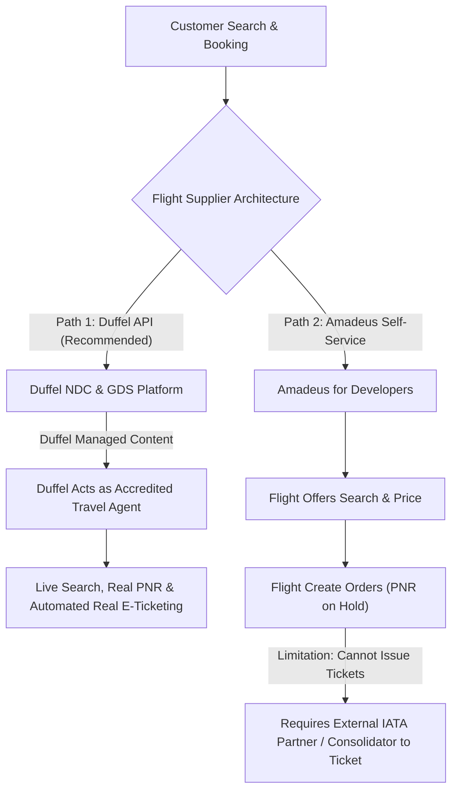
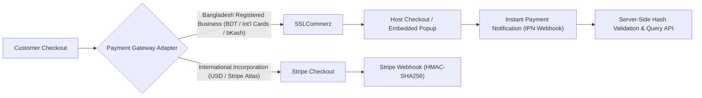
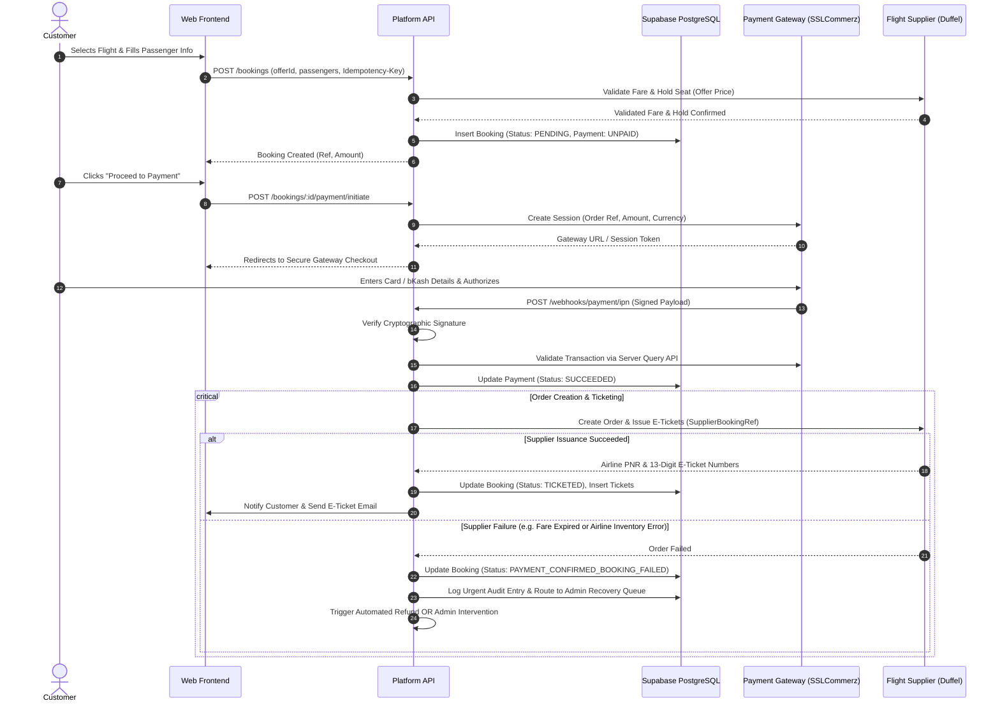
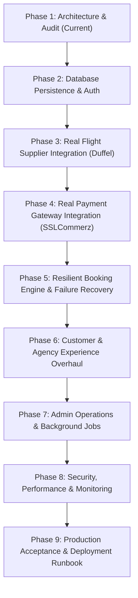

# Commercial Flight Booking Platform — MVP Audit & Production Architecture

**Document Type:** Commercial Upgrade Audit & Architecture Specification  
**Status:** Under User Review  
**Target Market & Entity:** Bangladesh-based operations serving local and international travelers & agencies  
**Target Infrastructure Spend:** $0 during development / testing; transparent operational unit costs at production launch  

---

## 1. Executive Summary & Audit Findings

The platform built in Milestones 1–7 represents a fully functional, architecturally sound modular monolith monorepo with 121 automated tests, strict TypeScript types, Drizzle database schemas, and edge runtime deployment configs. 

However, by design of the original PRD, it was built in **DEMO / MOCK mode**:
- Flight inventory is generated deterministically by an in-memory route matrix (`MockFlightSupplier`) with unmissable `[DEMO / MOCK]` labels.
- Booking confirmation creates random internal references without live Global Distribution System (GDS) or New Distribution Capability (NDC) reservations.
- Payments are simulated via four radio buttons (`SUCCESS`, `DECLINE`, `TIMEOUT`, `INSUFFICIENT_FUNDS`).
- Tickets are generated as `001-DEMO-XXXXXXXXXX` pseudo-records.
- Master entities are currently held in ephemeral in-memory Maps (`bookingsStore`, `paymentsStore`, etc.) within Cloudflare Workers isolates, while the Drizzle PostgreSQL schemas in `packages/db` await full operational binding.
- Authentication relies on a development `UserSwitcher` component with `x-demo-user-id` headers.

To evolve this into a **genuine, commercially usable product**, we must replace these simulated components with production-grade integrations, persistent PostgreSQL operations, real bank payment gateways, live airline supplier adapters, authentic customer dashboards, and robust failure recovery mechanisms.

---

## 2. Detailed Audit: Existing Assets vs. Mock Replacements

### 2.1 Core Assets to Preserve (Production-Grade Foundation)
The existing codebase contains high-value architectural assets that should **not** be discarded or rewritten:

1. **Clean Adapter Boundaries (`FlightSupplierAdapter`):** The supplier interface in `apps/api/src/modules/supplier/adapter.ts` cleanly isolates flight search, price validation, reservation, ticketing, and cancellation. This allows plugging in real suppliers (Duffel, Amadeus) with zero disruption to the booking engine.
2. **Pricing Engine & Markup Calculation:** The mathematical markup calculations (base fare + percentage markup + tax snapshotting) in `packages/shared` and `bookingService` are solid, transparent, and compliant with PRD rules.
3. **Agency Model & Business Rules:**
   - Strict 1:1 active agency-to-customer constraint.
   - Cryptographically hashed invitation tokens (SHA-256) with expiration.
   - Explicit customer consent workflow (Accept / Reject invitation).
   - Agency owners booking on behalf of associated customers with multi-party visibility.
4. **Idempotency Architecture:** The `Idempotency-Key` headers on booking creation and payment processing prevent duplicate reservations and double-charging.
5. **Cancellation Workflow & State Preservation:** Customer cancellation requests transition bookings to `CANCELLATION_PENDING`. Administrator review queue properly restores prior state (`TICKETED`) upon rejection or transitions to `CANCELLED` upon approval.
6. **Immutable Audit Logging:** Append-only structured action history (`auditService`) tracking every operational, payment, and cancellation event.
7. **Dynamic Operational Metrics:** Real-time KPI calculations (GBV, booking conversion, cancellation queues).
8. **Relational Schema Definitions:** Drizzle ORM schemas in `packages/db` already define relational tables for users, agencies, bookings, passengers, payments, tickets, and audit logs.

### 2.2 Complete Demo / Mock Functionality Inventory (To Be Replaced)

| Component | Current Implementation | Commercial Production Requirement |
| :--- | :--- | :--- |
| **Flight Supplier** | `MockFlightSupplier` with 15 hardcoded routes & static pricing | Real flight supplier adapter (Duffel API / Amadeus) with real airline schedules, live seat availability, and live fare classes. |
| **PNR & Reservation** | Random 6-character string (`Math.random().toString(36)...`) | Real airline Record Locator (PNR) generated by the operating carrier via GDS/NDC. |
| **Payment Gateway** | `PaymentModal` with 4 scenario buttons; pseudo-IDs `PAY-XXXXXX` | Real payment gateway integration (SSLCommerz / Stripe) with secure checkout, webhook signature verification, and automated settlement. |
| **Ticket Issuance** | Fake 13-digit numbers (`001-DEMO-XXXXXXXXXX`) | Electronic Ticket documents issued by accredited ticketing authority (Duffel Managed Content or IATA partner). |
| **Data Persistence** | In-memory `Map<string, T>` stores in Cloudflare Worker memory | Full relational persistence to Supabase PostgreSQL database via Drizzle ORM with ACID transactions. |
| **Authentication** | Demo `UserSwitcher` component with `x-demo-user-id` headers | Supabase Auth (Email/Password, JWT sessions, secure cookie/bearer token, password reset, email verification). |
| **UI Badges & Banners** | Amber `DEMO / MOCK ENVIRONMENT` banner and `[DEMO / MOCK]` cards | Clean, high-converting commercial UI, real airline logos, and authentic travel document previews. |
| **Customer Documents** | Screen preview only | Downloadable, printable PDF e-tickets & booking vouchers with official airline PNR and barcode/QR. |
| **Notifications** | None | Transactional email notifications (booking confirmation, e-ticket delivery, payment receipts, cancellation alerts). |

---

## 3. Flight Supplier Evaluation & Feasibility

Selling airline tickets commercially has strict regulatory and technical requirements. There are two primary pathways for our platform:

### 3.1 Option A: Duffel API (Strongly Recommended for Commercial Launch)
- **Why It Fits:** Duffel is built specifically for tech companies and modern travel platforms that **do not hold their own IATA or ARC accreditation**.
- **How Ticketing Works:** Under "Duffel Managed Content", Duffel acts as the licensed Travel Agent of Record and Merchant of Record for airlines. The platform can search, hold fares, book PNRs, and **instantly issue valid electronic tickets** across 300+ global airlines.
- **Developer Sandbox:** Completely free test mode (`duffel_test_...`) with a dedicated sandbox airline (`Duffel Airways - ZZ`) plus simulated live airline sandboxes (British Airways, Lufthansa, American Airlines) that generate real JSON order objects, ticket documents, and refund flows.
- **Cost & Commercial Terms:**
  - Sandbox: **$0.00**.
  - Production: ~£2 to £3 ($2.50–$3.80) per booked order, or small markup margin. Zero multi-thousand-dollar GDS license fees; zero IATA bank guarantee requirements.

### 3.2 Option B: Amadeus Self-Service APIs
- **Capabilities:** High-volume GDS search (`Flight Offers Search`), real-time fare pricing (`Flight Offers Price`), and reservation creation (`Flight Create Orders`).
- **Critical Commercial Limitation:** Amadeus Self-Service **CANNOT issue electronic tickets**. It creates a reservation/PNR in the airline system, but the ticket must be fulfilled by an accredited IATA agency or consolidator.
- **Cost:** 2,000 free search calls/month in test environment; production charges ~€0.002 per search and ~€0.25 per booking.

### 3.3 Recommended Supplier Architecture: Pluggable Multi-Supplier
We will expand the existing `FlightSupplierAdapter` to support:
1. `DuffelSupplierAdapter`: Primary end-to-end engine for live flight search, real NDC fares, PNR reservation, and automated ticket issuance.
2. `AmadeusSupplierAdapter`: Optional secondary provider for GDS route comparison.
3. `MockFlightSupplier`: Retained as an automated test fixture for CI/CD test suites.

---

## 4. Payment Gateway Strategy (Bangladesh Entity Focus)

Operating a commercial travel platform from Bangladesh introduces specific regulatory constraints from Bangladesh Bank regarding foreign exchange and merchant acquiring:

### 4.1 Payment Gateway Comparison for Bangladesh Operations

| Criteria | **SSLCommerz (Recommended Primary)** | **bKash Direct Merchant** | **Stripe (Direct)** | **Stripe (via Stripe Atlas US LLC)** |
| :--- | :--- | :--- | :--- | :--- |
| **Eligible for BD Trade License?** | **Yes (100% Licensed & Supported)** | Yes | **No (Bangladesh not supported)** | Yes (requires US LLC formation) |
| **Card Acceptance** | Visa, Mastercard, Amex, Nexus (Local + International) | bKash Wallet only | Global Cards, Apple Pay, Google Pay | Global Cards, Apple Pay, Google Pay |
| **Mobile Banking (MFS)** | bKash, Nagad, Rocket, Upay included in one checkout | bKash only | None | None |
| **Settlement Currencies** | BDT (direct to any BD bank); multi-currency USD support | BDT | USD, EUR, GBP | USD, EUR, GBP |
| **Sandbox Environment** | **Free Instant Sandbox** (`sandbox.sslcommerz.com`) | Free Sandbox | Free Test Mode | Free Test Mode |
| **Security & Webhooks** | Server IPN with MD5 signature + validation query API | Webhook + Token Refresh | Webhook (`stripe-signature` HMAC) | Webhook (`stripe-signature` HMAC) |
| **Transaction Fees** | ~2.0%–2.5% (Local / MFS); ~3.5% (International Cards) | ~1.5%–1.8% | 2.9% + $0.30 | 2.9% + $0.30 + cross-border fees |

### 4.2 Recommended Payment Architecture: `PaymentGatewayAdapter`
We will implement an extensible `PaymentGatewayAdapter` interface:
1. **`SSLCommerzAdapter` (Primary):**
   - Initiates payment session with SSLCommerz Gateway API (`/gwprocess/v4/api.php`).
   - Renders secure hosted/modal checkout where customers pay via Credit/Debit Card or bKash/Nagad.
   - Listens to server-to-server IPN webhooks with MD5 signature validation.
   - Executes server-side transaction status query (`/validator/api/validationserverAPI.php`) before confirming booking.
   - Handles refund requests via SSLCommerz Refund API (`/validator/api/merchantTransIDvalidationAPI.php`).
2. **`StripeAdapter` (Secondary):**
   - Implemented as a pluggable alternative, ready to activate if the business operates a Stripe Atlas US/UK entity.

---

## 5. Complete Commercial Booking Lifecycle & Partial Failure Recovery

In a real-world travel platform, network or supplier failures can occur mid-transaction. The booking engine must handle partial failures gracefully without leaving customers stranded or money unallocated.

### 5.1 Handling Partial Failure Scenarios

1. **Payment Succeeded, but Airline Reservation Fails:**
   - **Risk:** Customer's card was charged, but airline inventory sold out or price changed between search and ticketing.
   - **Resolution:** Booking transitions to `PAYMENT_CONFIRMED_BOOKING_FAILED`. An automated compensation routine triggers an immediate refund request to the payment gateway, or flags the booking in the Admin Recovery Queue for alternative flight re-protection within SLA.
2. **Airline PNR Created, but Payment Webhook Delayed / Dropped:**
   - **Risk:** Customer completed bank 3D-Secure, but browser was closed before returning to merchant URL.
   - **Resolution:** Platform uses server-to-server IPN webhooks independent of the browser. Additionally, a background cron job polls the payment gateway for any `PENDING` bookings older than 10 minutes to verify transaction status.
3. **Airline PNR Created & Paid, but Instant Ticketing Encounters Delay:**
   - **Risk:** Some airlines (or consolidation desks) require up to a few hours to issue ticket numbers.
   - **Resolution:** Booking transitions to `BOOKED_TICKETING_PENDING`. It surfaces immediately in the Admin Ticketing Queue, and customers receive a clear notice: *"Your flight reservation (PNR XXXXXX) is confirmed. Your official electronic ticket is being processed and will be delivered shortly."*

---

## 6. Security, Production Reliability & Compliance

1. **Cardholder Data Security (PCI-DSS Compliance):**
   - Raw card numbers, expiration dates, and CVVs **never touch our servers or database**.
   - All card entry is handled via PCI-DSS compliant hosted checkout (SSLCommerz) or tokenized client-side iframes (Stripe Elements).
2. **Cryptographic Webhook Verification:**
   - SSLCommerz IPN payloads are verified using MD5 hash string comparison.
   - Reverse validation API call is made server-to-server to prevent forged webhook attacks.
3. **Rate Limiting & Anti-Scraping:**
   - Flight search endpoints protected with rate limiting (e.g. 30 requests/minute per IP) to prevent bot scraping and quota depletion on supplier APIs.
4. **Database Integrity & Transactions:**
   - Database operations (booking + passenger creation; payment + ticket updates) wrapped in PostgreSQL transactions.
   - Foreign key constraints, unique PNR constraints, and enum validations enforced at the database level.
5. **Secrets Management:**
   - All supplier API tokens (`DUFFEL_TOKEN`, `AMADEUS_CLIENT_SECRET`), payment keys (`SSLCOMMERZ_STORE_PASS`, `STRIPE_WEBHOOK_SECRET`), and database credentials stored exclusively in Cloudflare encrypted secrets or environment variables. Zero hardcoded credentials.

---

## 7. Phased Implementation Roadmap

- **Phase 1: Audit, Requirements & Architecture Approval (Current Milestone)**
  - Finalize provider choices (Duffel for flight ticketing, SSLCommerz for payments).
  - Align on business decisions and pricing models.
- **Phase 2: Database Persistence & Production Authentication**
  - Migrate all domain services from in-memory Maps to PostgreSQL via Drizzle ORM.
  - Bind Supabase Auth with real login, registration, email confirmation, and session tokens.
- **Phase 3: Real Flight Supplier Integration (Duffel NDC/GDS)**
  - Implement `DuffelFlightSupplierAdapter` with live search, fare validation, seat availability, and baggage rules.
  - Implement real PNR generation and automated electronic ticket issuance.
- **Phase 4: Real Payment Gateway Integration (SSLCommerz)**
  - Implement `SSLCommerzAdapter` with session initialization, hosted/popup checkout, IPN webhook listener, and validation query API.
  - Implement automated refund request workflows.
- **Phase 5: Resilient Booking Engine & Failure Recovery**
  - Connect booking engine to live supplier and payment adapters.
  - Implement partial failure compensation (auto-refund on booking failure, admin queue routing).
- **Phase 6: Customer & Agency Experience Overhaul**
  - Remove all demo tags, banners, and mock personas.
  - Build real flight cards with airline logos, accurate baggage rules, and fare details.
  - Generate downloadable PDF e-tickets and confirmation receipts.
  - Add transactional email notifications via Resend/SendGrid.
- **Phase 7: Admin Operations & Background Reconciliation**
  - Enhance admin panel with real supplier reference lookups, transaction query tools, manual ticket fulfillment, and cancellation processing.
  - Add background cron job for unconfirmed booking reconciliation.
- **Phase 8: Security, Rate Limiting & Production Testing**
  - Add rate limiting, security headers, input sanitization, and automated integration test coverage.
- **Phase 9: Production Deployment & Acceptance Verification**
  - Deploy to Cloudflare Workers / Pages with production database bindings and run full acceptance testing.
